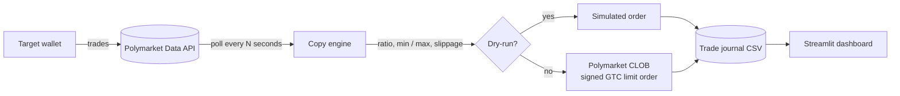

# Polymarket Copy Trading Bot


Mirror the trades of any [Polymarket](https://polymarket.com) wallet automatically, sized to your own bankroll and
bounded by your own risk limits. Comes with a **Streamlit dashboard** to configure and monitor the bot, and a
**headless command-line runner** for servers.

> [!WARNING]
> This software places real orders with real money when live mode is enabled. It is provided for educational
> purposes, **without any warranty**. Prediction markets are risky, past performance of a trader does not predict
> future results, and you may lose all the funds you commit. Check that using Polymarket is legal in your
> jurisdiction. Start in **dry-run mode** and only use a dedicated wallet holding funds you can afford to lose.

---

## Table of contents

- [Features](#features)
- [How it works](#how-it-works)
- [Project structure](#project-structure)
- [Getting started](#getting-started)
- [Configuration](#configuration)
- [Usage](#usage)
- [Copy sizing and risk controls](#copy-sizing-and-risk-controls)
- [Security](#security)
- [Development](#development)
- [Known limitations](#known-limitations)
- [Roadmap](#roadmap)
- [Contributing](#contributing)
- [License](#license)

## Features

- 🔁 **Automatic copy trading**: detects every new `BUY` / `SELL` of a target wallet and mirrors it on your account.
- 📏 **Proportional sizing**: copy a percentage of each target order, with a minimum and a maximum order size.
- 🎯 **Slippage tolerance**: limit price adjusted by a configurable tolerance so copies still fill when the price moves.
- 🧪 **Dry-run mode (default)**: simulate every order without sending anything, to validate a strategy safely.
- 🛡️ **Safe start-up**: trades made before the engine started are never copied, and each trade is copied only once.
- 📊 **Dashboard**: positions value, open positions with PnL, copied volume chart and full copy journal.
- 👀 **Live target feed**: paginated, colour-coded activity of the target wallet (`BUY`, `SELL`, `REDEEM`, ...),
  refreshed automatically.
- 🖥️ **Headless mode**: `python -m copytrader` runs the same engine from a terminal, a `tmux` session or a server.
- 📝 **Trade journal**: every processed trade (executed, simulated, skipped or failed) is appended to a CSV file.
- 🔐 **Secrets stay out of the UI**: the private key is only read from the environment, never typed in the browser.

## How it works



1. **Prime**: on start, the engine loads the target's recent trades and marks them as already seen.
2. **Poll**: every `POLL_INTERVAL_SECONDS`, it fetches the target's latest trades from the public
   [Data API](https://docs.polymarket.com/) and keeps only those it has never seen.
3. **Size**: each new trade is converted into an order using your copy ratio, limits and slippage tolerance.
4. **Execute**: the order is signed and posted to the Polymarket CLOB through
   [`py-clob-client`](https://github.com/Polymarket/py-clob-client), or only simulated in dry-run mode.
5. **Record**: the result is written to the trade journal and shown in the dashboard.

## Project structure

```text
polymarket_copy_trading_bot/
├── app.py                     # Streamlit entry point (streamlit run app.py)
├── copytrader/                # Application package
│   ├── __main__.py            # Headless entry point (python -m copytrader)
│   ├── cli.py                 # Command-line runner and arguments
│   ├── config.py              # Settings loaded from environment variables / .env
│   ├── engine.py              # Copy engine: new trade detection and execution (UI independent)
│   ├── sizing.py              # Order sizing, limits and slippage
│   ├── journal.py             # CSV journal of processed trades
│   ├── models.py              # Domain models (Activity, CopyOrder, CopyResult)
│   ├── api/
│   │   ├── data_api.py        # Public Polymarket Data API client (activity, positions, value)
│   │   └── clob.py            # Order executors: live CLOB and dry-run
│   └── ui/
│       ├── state.py           # Streamlit session state and engine lifecycle
│       ├── components.py      # Header, engine controls and polling loop
│       ├── data.py            # Cached loaders producing display-ready DataFrames
│       ├── styles.py          # Table colour helpers
│       └── pages/             # Dashboard, Target wallet and Settings pages
├── tests/                     # Unit tests (pytest), no network access required
├── .env.example               # Configuration template
├── requirements.txt           # Runtime dependencies
├── requirements-dev.txt       # Development dependencies (pytest, ruff)
└── pyproject.toml             # Project metadata and tooling configuration
```

## Getting started

### Prerequisites

- Python **3.10** or newer
- A Polymarket account funded with USDC on Polygon (only for live trading)
- The address of the wallet you want to copy (visible in the URL of a trader's Polymarket profile)

### Installation

```bash
git clone https://github.com/STERN3L/polymarket_copy_trading_bot.git
cd polymarket_copy_trading_bot

python -m venv .venv
source .venv/bin/activate        # Windows: .venv\Scripts\activate

pip install -r requirements.txt
cp .env.example .env             # then edit .env
```

## Configuration

All settings are read from environment variables, or from a `.env` file at the root of the project.
The values used by the web dashboard can also be changed from its **Settings** page for the current session.

| Variable                    | Default                | Description                                                                 |
| --------------------------- | ---------------------- | --------------------------------------------------------------------------- |
| `TARGET_WALLET`             | —                      | Polymarket address of the trader to copy. **Required.**                     |
| `POLYMARKET_PRIVATE_KEY`    | —                      | Private key signing your orders. Required for live trading only.            |
| `POLYMARKET_FUNDER_ADDRESS` | —                      | Address shown on your Polymarket profile (holds your USDC).                 |
| `POLYMARKET_SIGNATURE_TYPE` | `2`                    | `0` EOA, `1` email / Magic login, `2` browser wallet (MetaMask, ...).       |
| `COPY_RATIO_PERCENT`        | `10`                   | Percentage of each target order to copy (`0` < ratio ≤ `1000`).             |
| `MIN_ORDER_USDC`            | `1`                    | Copies smaller than this amount are skipped.                                |
| `MAX_ORDER_USDC`            | `100`                  | Copies larger than this amount are capped.                                  |
| `MAX_SLIPPAGE_PERCENT`      | `2`                    | Price tolerance added to buys / removed from sells.                         |
| `POLL_INTERVAL_SECONDS`     | `30`                   | Delay between two checks of the target wallet (minimum `5`).                |
| `DRY_RUN`                   | `true`                 | `true` simulates orders, `false` sends real orders.                         |
| `JOURNAL_PATH`              | `data/copy_trades.csv` | Location of the trade journal.                                              |

> [!TIP]
> **Which signature type?** If you log in to Polymarket with an email, use `1` and export the private key from
> Polymarket's settings. If you log in with MetaMask or another browser wallet, use `2` and that wallet's key.
> In both cases `POLYMARKET_FUNDER_ADDRESS` is the address displayed on your Polymarket profile.

## Usage

### Web dashboard

```bash
streamlit run app.py
```

Then open <http://localhost:8501>:

| Page              | Content                                                                                 |
| ----------------- | --------------------------------------------------------------------------------------- |
| **Dashboard**     | Positions value, number of copies, copied volume, failed orders, journal and positions. |
| **Target wallet** | Live activity of the copied wallet, colour coded and paginated.                         |
| **Settings**      | Wallets, signature type, copy ratio, limits, polling interval and execution mode.       |

Use the **Start engine** button in the header to begin copying. The engine polls the target wallet in the
background as long as the dashboard tab stays open; use the headless mode for unattended operation.

### Headless mode

```bash
python -m copytrader                       # uses .env
python -m copytrader --target 0x... --ratio 5 --interval 15
python -m copytrader --once -v             # single cycle with debug logs
python -m copytrader --live                # send real orders (overrides DRY_RUN)
```

| Option                 | Description                                         |
| ---------------------- | --------------------------------------------------- |
| `--env-file PATH`      | Load another `.env` file.                           |
| `--target ADDRESS`     | Wallet to copy (overrides `TARGET_WALLET`).         |
| `--ratio PERCENT`      | Copy ratio (overrides `COPY_RATIO_PERCENT`).        |
| `--interval SECONDS`   | Polling interval (overrides `POLL_INTERVAL_SECONDS`). |
| `--live` / `--dry-run` | Force live or simulated execution.                  |
| `--once`               | Run a single polling cycle and exit.                |
| `-v`, `--verbose`      | Enable debug logging.                               |

Both modes write to the same trade journal, so you can run the engine headless and watch the results in the
dashboard (without starting the engine there).

## Copy sizing and risk controls

For each new trade of the target wallet:

```text
copy amount = min(target amount × COPY_RATIO_PERCENT / 100, MAX_ORDER_USDC)
limit price = target price × (1 + slippage)     for a BUY
            = target price × (1 − slippage)     for a SELL     (clamped to [0.01, 0.99])
shares      = copy amount / limit price
```

The copy is **skipped** if the amount is below `MIN_ORDER_USDC`, the price is invalid, or the activity is not a
trade (redeems, splits and merges are not copied). Orders are sent as **GTC limit orders**.

**Example** with a ratio of `10%`, a maximum of `100 USDC` and a slippage of `2%`:

| Target trade                 | Your copy                                      |
| ---------------------------- | ---------------------------------------------- |
| BUY 500 USDC of "Yes" @ 0.40 | BUY 50 USDC → 121.95 shares @ 0.41             |
| BUY 3,000 USDC @ 0.70        | BUY 100 USDC (capped) → 140.85 shares @ 0.71   |
| BUY 8 USDC @ 0.55            | Skipped: 0.80 USDC is below the 1 USDC minimum |

## Security

- **Never commit your `.env` file.** It is listed in `.gitignore`; double-check with `git status` before pushing.
- Use a **dedicated wallet** holding only the amount you are ready to lose, never your main wallet.
- The private key is only loaded from the environment and is never displayed, logged or entered in the web UI.
- The dashboard has no authentication: keep it bound to `localhost`, or put it behind an authenticated reverse proxy
  if you expose it.
- Keep `DRY_RUN=true` until the journal shows exactly the behaviour you expect.

## Development

```bash
pip install -r requirements-dev.txt

pytest                 # run the unit tests (offline)
ruff check .           # lint
ruff format .          # format
```

The copy engine has no dependency on Streamlit: the API clients and the order executor are injected, which makes it
easy to test with fakes (see `tests/test_engine.py`) or to reuse in another interface.

## Known limitations

- **Polling, not streaming**: trades are detected with a delay of up to `POLL_INTERVAL_SECONDS` plus the indexing delay
  of the Data API, so your entry price can differ from the target's.
- **Limit orders may not fill**: if the price moves beyond the slippage tolerance, the GTC order stays open on the
  book until it is filled or cancelled manually.
- **Sells are proportional, not position-aware**: a target `SELL` is copied with the same ratio, which fails if you
  do not hold enough shares of that outcome.
- **Engine state is in memory**: after a restart, the engine starts fresh and only copies trades made after it.
- **Dashboard engine needs an open tab**: Streamlit only runs while a browser session is active; use headless mode
  for 24/7 operation.

## Roadmap

- [ ] Position-aware sells (sell the same fraction of your position as the target)
- [ ] Persist engine state (seen trades) across restarts
- [ ] Copy several target wallets at once
- [ ] Notifications (Telegram / Discord) for executed and failed copies
- [ ] Docker image

## Contributing

Contributions are welcome. Please open an issue to discuss significant changes, keep the engine independent from the
UI, and make sure `pytest` and `ruff check .` pass before submitting a pull request.

## License

Distributed under the [MIT License](LICENSE). The software is provided "as is", without warranty of any kind:
the authors are not liable for any financial loss resulting from its use.

---

<sub>This project is not affiliated with, endorsed by, or sponsored by Polymarket.</sub>
